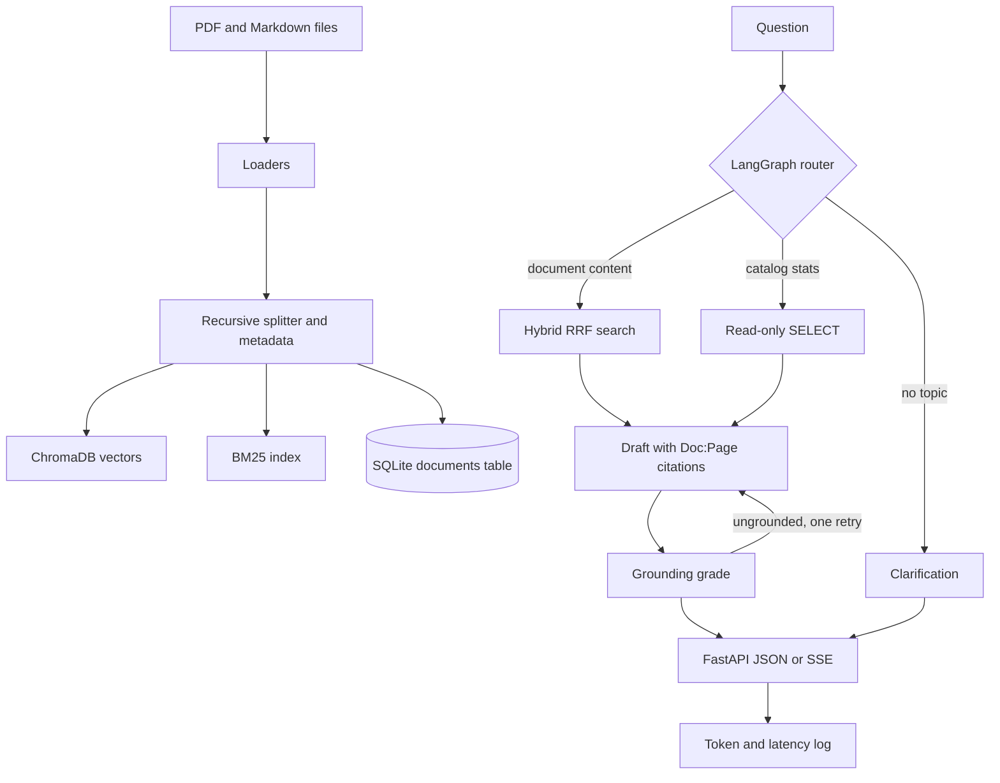

# DocuMind

DocuMind answers questions over a small library of PDF and Markdown files. A LangGraph state graph decides whether the question needs document search, a read-only catalog query, or a clarification. Document answers carry inline citations of the form `[handbook:3]`, and a grader checks that those citations were actually retrieved.

It runs locally with no API key. Point `LLM_PROVIDER` at OpenAI or Ollama when you want a hosted or local chat model. The retrieval graph, the citation schema, and the HTTP API stay the same.

## Features

- PDF and Markdown ingestion. Markdown is split on level-1 and level-2 headings; PDF pages keep the page numbers from the file.
- Recursive character chunking with overlap. Every chunk keeps the document id, filename, page, heading, and file type.
- Embeddings stored in ChromaDB, plus a BM25 keyword index over the same chunks. The two ranked lists are merged with reciprocal rank fusion.
- A LangGraph router with three branches: hybrid retrieval, a read-only SQL catalog tool, and a clarification step.
- Pydantic models that require inline `[Doc:Page]` markers to match the structured citation list. A separate grader checks that each citation was in the retrieved set and that the answer overlaps the cited text. Ungrounded answers are flagged `low_confidence`. One rewrite is allowed.
- A FastAPI service with a JSON endpoint and a server-sent-events stream, packaged with Docker.
- Chat completions through the OpenAI API or a local Ollama server. Each request appends a JSON line with route, token counts, and latency.

## Architecture



The citation label is the file stem, sanitized to letters, numbers, `_`, and `-`. `[policy:1]` is page 1 of `policy.pdf`. For Markdown, a "page" is a heading section, numbered from the top of the file.

## Layout

```
documind/
  config.py            environment settings
  schemas.py           citation and answer models
  ingestion/           PDF and Markdown loaders, recursive chunker
  retrieval/           hash or provider embeddings, BM25, Chroma, RRF
  sql/                 catalog table and the SELECT-only tool
  llm/                 OpenAI and Ollama chat clients
  graph/               LangGraph router, draft, and grader
  api/app.py           FastAPI endpoints
  cli.py               ingest, ask, serve
sample_data/           handbook, release notes, incident-policy PDF
tests/
```

`data/chunks.json` is the text corpus. Chroma holds vectors for the active provider. SQLite holds one row per ingested file so catalog questions ("how many documents") are not stuffed into the vector index.

## Run locally

Python 3.11 or newer.

```bash
python -m venv .venv
source .venv/bin/activate
pip install -r requirements.txt
cp .env.example .env
```

`LLM_PROVIDER` defaults to `local`. That mode uses feature-hashing embeddings and copies sentences out of the retrieved chunks. It is enough to try the router, the citations, and the API. It does not understand paraphrases. Use OpenAI or Ollama embeddings for that.

```bash
python -m documind ingest sample_data
python -m documind ask "How long are chat logs kept?"
python -m documind serve
```

The server also ingests `sample_data/` on startup when the index is empty (`AUTO_INGEST=true`).

```bash
curl -s localhost:8000/health
curl -s localhost:8000/query \
  -H 'content-type: application/json' \
  -d '{"question":"What is the on-call escalation code?"}'
curl -N localhost:8000/query/stream \
  -H 'content-type: application/json' \
  -d '{"question":"How many documents are ingested?"}'
```

Upload another PDF or Markdown file with `POST /ingest` (multipart field `file`). `POST /ingest/sample` indexes `CORPUS_DIR` again.

Token and latency lines are written to `logs/usage.jsonl` and to stdout. `token_source` is `provider` when the chat API reported usage, and `estimate` otherwise. Local mode always estimates, at about four characters per token.

## Docker

```bash
docker compose up --build
```

The API listens on port 8000 and ingests the sample library into the `documind-data` volume. Logs are bind-mounted at `./logs`.

To call OpenAI from the container, set `LLM_PROVIDER=openai` and `OPENAI_API_KEY` in `.env`, then `docker compose up --build`.

Ollama is a Compose profile. Pull the chat and embedding models once, then start both services:

```bash
docker compose --profile ollama up -d ollama
docker compose exec ollama ollama pull llama3.2
docker compose exec ollama ollama pull nomic-embed-text
LLM_PROVIDER=ollama docker compose --profile ollama up --build api
```

If Ollama is already running on the host, leave the profile off and set `OLLAMA_BASE_URL=http://host.docker.internal:11434` (or `http://localhost:11434` when the API itself is on the host).

Switching provider rebuilds vectors into a separate Chroma collection (`documind-local`, `documind-openai`, `documind-ollama`). The chunk JSON is shared.

## Tests

```bash
pip install -r requirements-dev.txt
pytest
ruff check documind tests
```

The tests use the local provider and temporary index directories. They do not call OpenAI or Ollama.

## Design decisions

**Recursive chunks, page metadata kept intact.** The splitter breaks on paragraphs and sentences before it falls back to characters, with overlap so a sentence on a boundary is not lost. The page number is not recomputed from the chunk; it stays the PDF page or the Markdown section. That is what `[Doc:Page]` points at.

**Hybrid search via reciprocal rank fusion.** BM25 is there for exact tokens such as `BLUE-17`. Dense search is there for wording that does not match the source. The two score scales are not comparable, so the merge uses rank: `1 / (60 + rank)` summed across the two lists.

**Local embeddings are a hashing trick.** Each token is added into a fixed-size vector and normalized. Repeated tokens line up; synonyms do not. The same store code calls OpenAI or Ollama embeddings when `LLM_PROVIDER` says so. No key is required for `local`.

**The router is a graph, not an open-ended agent loop.** Content questions go to retrieval. Questions about the catalog (document counts, page totals, file types, the file list) go to SQL. A question with no topic, such as "what about that", asks for a clarification instead of searching. "How many days are chat logs kept?" stays on retrieval, because the number is inside a document. "How many documents are ingested?" is SQL.

**SQL is read-only twice.** The statement has to be a single `SELECT` or `WITH`, and a keyword list rejects `INSERT`, `ATTACH`, `PRAGMA`, and the rest. The connection is opened with SQLite's `mode=ro`, so a statement that slipped past the parser still cannot write. Local mode picks the statement from a small set of templates. With OpenAI or Ollama, a template still wins when one matches; otherwise the model writes the `SELECT` and the same guards run.

**Citations are checked in two steps.** The Pydantic model rejects an answer whose inline `[Doc:Page]` markers and citation list disagree, and it rejects a grounded document answer with no citation. The grader then checks that every cited pair was in the retrieved chunks and that the answer's content words overlap the cited text (at least 35%). Confidence is `0.6 * citation precision + 0.4 * overlap`. `low_confidence` is set when the answer is ungrounded or the score is under `LOW_CONFIDENCE_THRESHOLD` (0.45). If a retrieved draft fails, the graph regenerates once with the grader's note and then stops. SQL answers are checked differently: every number in the sentence has to appear in the result rows. Clarifications carry no citation and are flagged low confidence because they are not an answer.

**Streaming.** `POST /query/stream` sends server-sent events: the route, retrieval hits or the SQL text, chat-model tokens when a model is in the loop, a `revising answer` status if the grader asks for the retry, and a final `result` payload with the graded answer. Local mode has no chat-model stream, so the finished answer is split into short pieces after grading. Clients can render tokens as they arrive and still treat `result` as the version that passed the schema.

**Logs.** One JSON object per request: timestamp, request id, route, model, prompt tokens, completion tokens, `token_source`, latency in milliseconds, grounded, and low confidence. Provider counts are used when the API returns them. Otherwise the log says `estimate`.
